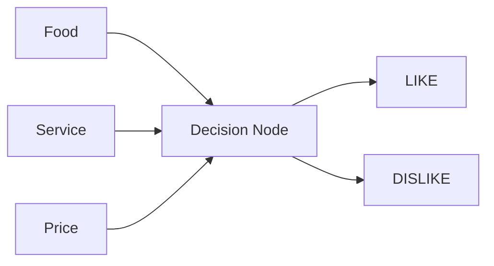

# Lab 8 — How a Neural Network Learns

## Objective

Simulate a decision-making neural network using restaurant ratings, track how its input weights change after feedback, and test whether those learned weights work on new scenarios.

## Network diagram

**Data flow:** The input feeder provides Food, Service, and Price. The decision node combines the feature values using weights, then predicts **one** output: LIKE or DISLIKE. Feedback from the actual customer opinion guides subsequent weight adjustments.

## Team roles

Fill in the actual people who participated:

| Role | Responsibility | Team member |
| --- | --- | --- |
| Input Feeder | Read each restaurant scenario | _Add name_ |
| Decision Node | Predict LIKE or DISLIKE | _Add name_ |
| Observer / Tracker | Record predictions, feedback, and weights | _Add name_ |

## Worked simulation — starting weights

| Feature | Initial tokens (weight) |
| --- | ---: |
| Food | 1 |
| Service | 4 |
| Price | 1 |

Each token represents one unit of importance. We intentionally start with a service-heavy model to illustrate how feedback can change what the model focuses on.

## Simple decision rule used for the simulation

| Feature level | Numerical value |
| --- | ---: |
| Food/Service: Excellent, Great, Good | +1 |
| Food/Service: Okay | 0 |
| Food/Service: Poor, Bad | -1 |
| Price: Cheap | +1 |
| Price: Moderate | 0 |
| Price: Expensive | -1 |

**Score = (Food value × Food weight) + (Service value × Service weight) + (Price value × Price weight).**

- Score **greater than 0** → LIKE.
- Score **0 or less** → DISLIKE.

This is a simplified weighted decision node, not a full trained artificial neural network. The activity demonstrates the idea of learning through feedback.

## Lab work

1. [Part A: all 10 training cards with predictions and weight history](training.md)
2. [Part B: all 3 test cards, accuracy, and team-comparison area](testing.md)
3. [Reflection on weights, mistakes, and real AI](reflection.md)

**Before submitting:** Confirm or replace the simulated results with your real activity, record actual team roles, and complete the comparison with another team.
